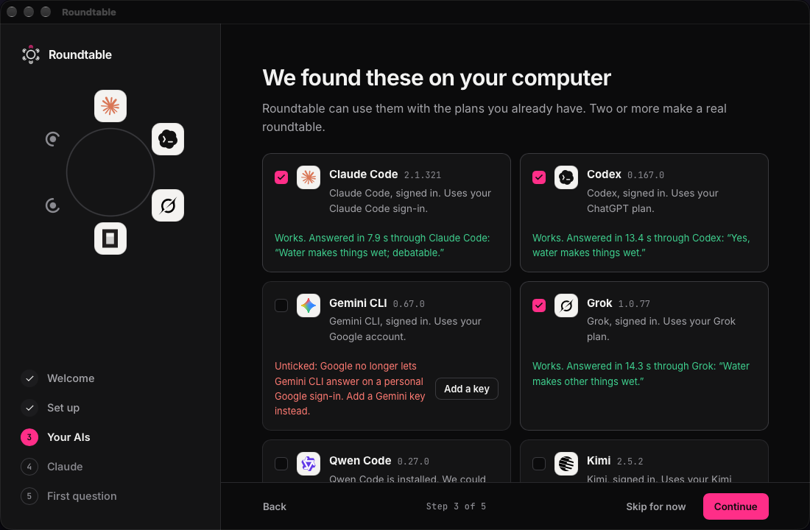
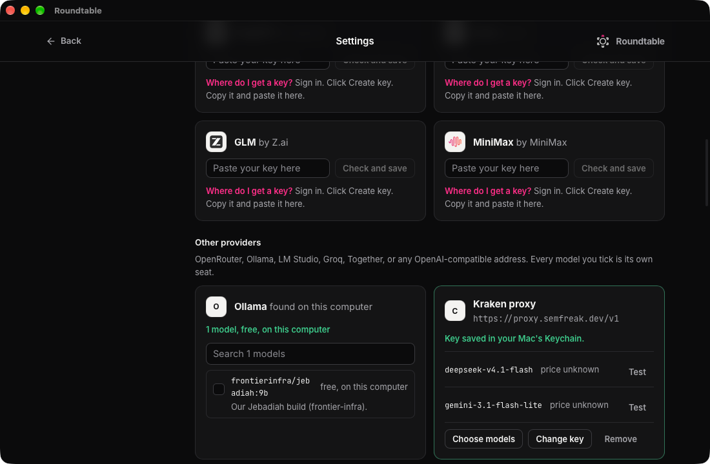

Roundtable needs at least one AI. Two or more make a real roundtable.

## Apps on this computer

Roundtable looks for AI apps you already use, such as Claude Code, Codex, Gemini CLI, Grok, Qwen Code, Kimi and OpenCode. It uses the plans you are signed in to. Nothing is sent until you ask a question.

- Tick an app to give it a seat at the table.
- Roundtable asks each ticked app one tiny test question, to check it works.
- An app that is installed but signed out shows Sign in. Finish signing in, then click Check again.

## API keys

If you have no AI app, paste an API key instead. Each card has a Where do I get a key? link.

- A chat plan like Claude Pro or ChatGPT Plus is not an API key.
- Keys are saved in your Mac's Keychain, or in Windows Credential Manager.
- Roundtable never shows a saved key again. You can replace or remove it.

## Other providers

In Settings, AI accounts, Add a provider connects OpenRouter, Ollama, LM Studio, Groq, Together, or any service that speaks the OpenAI format.

- Ollama and LM Studio are found by themselves when they run on this computer. They are free.
- Every model you tick gets its own seat.
- OpenRouter shows a price for each model. Roundtable uses it to estimate the cost before you ask.

## Who sits at the table

Settings, Who sits at the table picks which connected AIs answer by default. Keep at least one.
