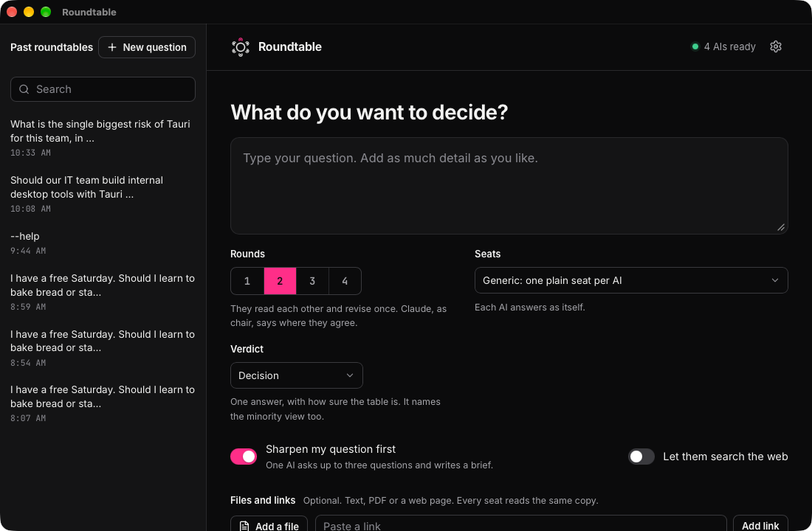
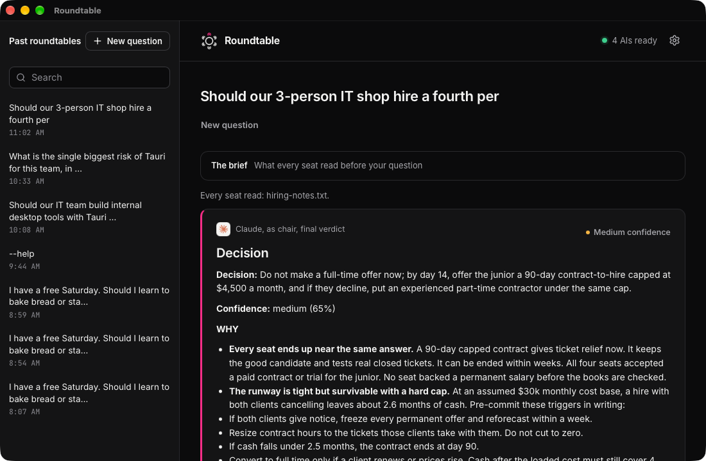

The first time Roundtable opens, it walks you through five short steps: Welcome, Set up, Your AIs, Claude and First question. You can skip a step and come back to it in Settings.

## Ask a question

1. Type your question in the big box. Add as much detail as you like.
2. Pick how many rounds. One round is fast. Two or more let the AIs read each other and revise.
3. Pick a verdict: a decision, pros and cons, an action plan, or a vote.
4. Click Ask the table, or press Cmd+Enter (Ctrl+Enter on Windows).

The line above the button says how many AIs it will ask and the most requests it can make. Each AI company charges your own account for its answers.

## Add files and links

Under Files and links, add a text file, a PDF or a web page. Every seat reads the same copy.

## Sharpen my question first

With this switch on, one AI asks you up to three short questions first. It turns your answers into a brief that every seat reads. You can edit the brief or skip it.

## Read the verdict

The verdict comes first. It gives one decision, how sure the table is, what would change it, and next steps. It also names the minority view.

Under the verdict, open each round to see what every AI said.

- Copy as Markdown copies the verdict.
- Download .md saves the verdict as a file. Export session saves every question and answer as one file.
- Follow up asks the whole table, or one seat, a new question. They read everything said so far.

## Past roundtables

Past roundtables stay on this computer, in the list on the left. Search them with the box above the list. Right-click one to open or delete it. A delete can be undone for a few seconds.
