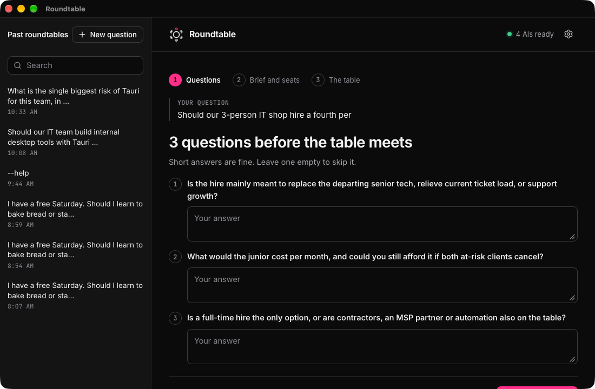
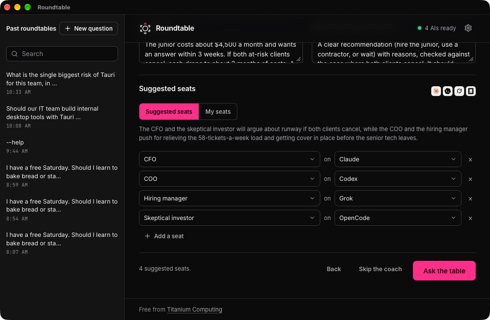

## Rounds

Pick 1 to 4 rounds in the ask box.

- Round 1 is blind. Each AI answers on its own, so nobody copies the first answer. You can turn this off in Settings, How the table works.
- In later rounds, each AI reads the others. It changes its mind or holds its ground.
- After each round, the chair names the leading pick and what is still open. The next round argues those points.

Claude is the chair. Two or more rounds work best with Claude connected.

## Personas

A persona gives a seat a role, such as CFO, Head of Sales or Security reviewer. The seat answers from that point of view.

- In the ask box, Seats picks a pack: business roles, expert panels, or simulated views of the big AI labs.
- Generic gives one plain seat per AI. Each AI answers as itself.
- Set each seat picks a persona and an AI for every seat yourself.

## The question coach and suggested seats

With Sharpen my question first on, the coach asks up to three short questions. Short answers are fine. Leave one empty to skip it.

From your answers, the coach writes a brief and suggests 2 to 4 seats. Keep them, change them, or switch to My seats.

## Write your own persona

Settings, Personas lists every persona. Click New persona to write one: a name, what it knows, how it should reason, and which AI plays it. Duplicate copies one to change. Export yours and Import a pack share personas as a file.
