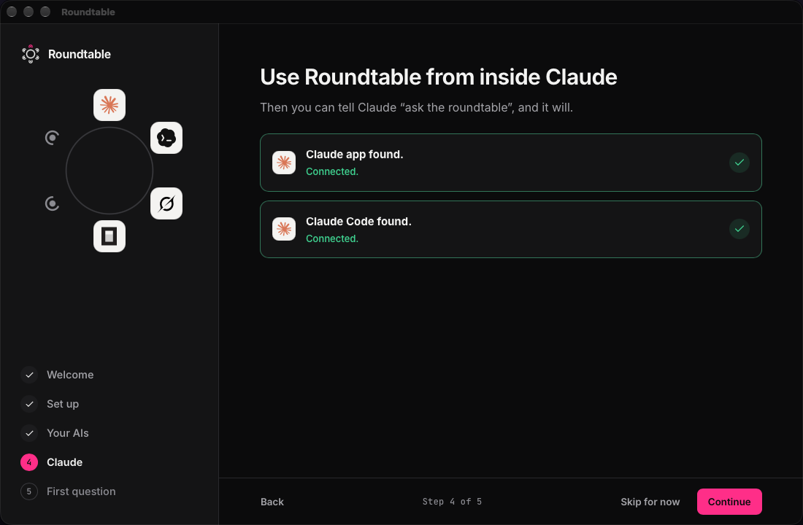

Connect Roundtable to Claude, and you can say "ask the roundtable" in a chat. Claude sends your question to the table and reads back the verdict.

## Connect

Setup step 4, or Settings, Claude connection:

- Claude app found: click Connect to the Claude app.
- Claude Code found: click Connect to Claude Code.
- Not on this computer yet? Click Download Claude.
- Using Claude Code on another computer? Paste the two lines shown into Claude Code.

Roundtable adds itself as a tool that Claude can call. Your keys stay in your keychain. Claude never sees them.

## Use it

In Claude, ask for a roundtable in plain words:

- "Ask the roundtable whether we should move the launch to March."
- "Get a second opinion from the roundtable on this plan, two rounds."

The roundtable shows up in your past roundtables in the app, marked Claude.

## Disconnect

Settings, Claude connection, Disconnect removes the tool from Claude. If the Roundtable plugin is also installed in Claude Code, click Use the app's engine instead, so Claude does not see two Roundtable tools.
